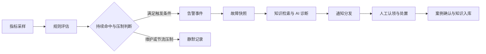

# Ops Agent · Spring AI 版本

基于 Spring AI、RAG 与 Tool Calling 的运维诊断后端，提供自然语言问答、服务健康与指标查询、告警诊断、通知及知识沉淀。

## 版本与分支定位

| 分支 | 定位 |
| --- | --- |
| `maintenance/spring-ai`（当前） | 保留迁移前的 Spring AI 实现，作为历史版本与迁移对照基线；暂时停止日常功能开发 |
| `migration/langchain4j` | 后续迁移与开发分支，逐步引入 LangChain4j、多步自主规划及 MCP 工具接入 |

本 README 描述当前 Spring AI 分支的实现。迁移分支的能力、依赖及启动方式以后续该分支文档为准。保留基线不代表所有功能均已完成端到端验收，测试结果应以对应报告为准。

当前重点是“发现问题 → 辅助诊断 → 通知 → 人工处置 → 知识沉淀”。自主规划、多 Agent 协作、自动部署、巡检、修复与回滚属于后续演进目标，当前版本尚未形成这些操作的自动执行闭环。

## 当前功能

### 运维问答与服务查询

- 自然语言问答、SSE 流式输出、知识引用与诊断追问。
- 工具查询服务健康、指标、指标列表和服务状态；服务地址由数据库注册中心解析。
- 多轮会话持久化，内存 ChatMemory 缓存与数据库历史回填。
- 服务注册、更新、下线及定时健康检查。

### 知识入库与检索

- Markdown、TXT、PDF、DOCX 文档解析与版本管理。
- Markdown 结构化切分、递归边界切分与 Token 兜底策略。
- Pgvector 向量检索、内存 BM25、RRF 融合；可选百炼 Reranker，主配置默认关闭。
- 文档审核与发布状态分离，异步索引任务、失败重试及重建索引。
- 故障案例生成、确认与修正，检索命中、引用溯源及质量评估。
- `KeywordRetriever` 保留扩展接口；PostgreSQL / Elasticsearch 关键词实现与 ES 向量检索尚未在本分支落地。

### 告警与诊断闭环



- 阈值、同比变化率与统计偏差规则，持续命中、去重和节流。
- `FIRING / ACKNOWLEDGED / SILENCED / RESOLVED` 状态，认领、确认、静默、批量操作、恢复与已读统计。
- 故障快照、结构化 AI 诊断、失败展示、手动重试及后续追问。
- 维护窗口、人工静默、多级升级及主 / 备 / 管理员值班路由。
- 邮件、飞书 Webhook、通用 Webhook 渠道，投递记录与失败定时重试。

快照、诊断及通知各环节独立容错；诊断失败时仍可发送基础告警通知。上述清单表示已有实现，不代表维护、升级和重试等所有分支均已通过页面回归。

### 权限与治理

- Spring Security + JWT + RBAC，租户、部门及数据权限隔离。
- 操作审计、接口限流、敏感字段加密与响应脱敏。
- 异步任务上下文传播，外部调用超时、重试与熔断。

## 技术栈

版本以当前分支 `pom.xml` 为准。

| 层级 | 当前实现 |
| --- | --- |
| 语言 | Java 21 |
| 应用框架 | Spring Boot 4.1.2 |
| AI 框架 | Spring AI 2.0.2 |
| 对话模型 | DeepSeek，OpenAI 兼容协议 |
| Embedding | 百炼 `text-embedding-v3`，1024 维 |
| 可选重排序 | 百炼 `gte-rerank-v2`，默认关闭 |
| 数据库与向量存储 | PostgreSQL 16 + Pgvector（HNSW / Cosine） |
| 数据访问 | MyBatis-Plus 3.5.18 |
| Web 与流式输出 | Spring MVC、WebFlux / Reactor、SSE |
| API 文档 | springdoc-openapi 3.2.0 |
| 通知与文档解析 | JavaMail、Apache POI、PDFBox |
| 测试 | JUnit、Mockito、AssertJ、Reactor Test、JaCoCo |

## 本地启动

### 1. 准备环境

- JDK 21；使用仓库 Maven Wrapper，或本机 Maven。
- Docker Desktop / Docker Compose，或自行准备 PostgreSQL + Pgvector。
- DeepSeek 与百炼 API Key。
- 前端位于同级独立仓库 `../ops-agent-frontend/`，需按其文档单独启动。

### 2. 启动数据库

在项目根目录执行：

```powershell
Copy-Item .env.example .env
# 编辑 .env，设置 DB_PASSWORD 等数据库参数
docker compose up -d
```

默认数据库地址为 `localhost:5433/opsdb`，用户名 `postgres`。Compose 只启动数据库，不启动后端、前端或 todo-service。

初始化脚本 `init-scripts/schema.sql`、`init-scripts/seed.sql` 仅在数据库数据目录首次初始化时执行。已有数据卷升级时需核对并单独应用增量 SQL，不能依靠重启容器更新表结构。

### 3. 配置后端

默认启用 `local` profile。在 IDE 运行配置中设置以下环境变量，或在 `src/main/resources/application-local.yml` 中覆盖对应配置：

| 环境变量 | 用途 |
| --- | --- |
| `DB_PASSWORD` | 数据库密码，与 Compose 配置保持一致 |
| `AI_API_KEY` | DeepSeek 对话模型密钥 |
| `DASHSCOPE_API_KEY` | 百炼 Embedding / 可选 Reranker 密钥 |
| `JWT_SECRET` | JWT 签名密钥，按 UTF-8 字节至少 32 字节 |
| `OPS_AES_KEY` | Base64 编码的 32 字节 AES 密钥 |
| `SMTP_HOST / SMTP_PORT / SMTP_USERNAME / SMTP_PASSWORD` | 可选，邮件通知所需 SMTP 配置 |

`.env` 由 Docker Compose 读取，Spring Boot 不会自动读取其中的变量；后端必须单独配置。修改 Compose 的数据库端口、库名或用户时，也需同步 `spring.datasource.*`。

本地覆盖文件示例（占位符需替换为自己的配置）：

```yaml
spring:
  datasource:
    password: "<数据库密码>"
  ai:
    openai:
      api-key: "<DeepSeek API Key>"
      embedding:
        api-key: "<百炼 API Key>"

ops-agent:
  security:
    jwt:
      secret: "<至少32字节的随机签名密钥>"
  crypto:
    aes-key: "<Base64编码的32字节密钥>"
```

`.env` 和 `application-local.yml` 已被 Git 忽略，真实凭据不要写入提交。模型、向量维度及数据库索引须保持匹配。

### 4. 启动后端

```powershell
.\mvnw.cmd spring-boot:run
```

Linux / macOS 使用 `./mvnw`。首次启动或内置知识变更时会调用 Embedding 模型建立增量索引，需确保网络、密钥和数据库可用。用户上传文档及案例的索引由异步任务处理。

### 5. 验证入口

| 用途 | 地址 / 接口 |
| --- | --- |
| 基础健康 | `http://localhost:8080/actuator/health` |
| Swagger UI | `http://localhost:8080/swagger-ui.html` |
| OpenAPI JSON | `http://localhost:8080/v3/api-docs` |
| 流式问答 | `POST /api/ops/ask/stream` |

业务接口需按权限携带 `Authorization: Bearer <token>`。流式请求体为 `{ "question": "todo-service 是否健康？", "sessionId": "<会话ID>" }`；前端通过 fetch 解析 SSE，成功流包含答案 token、`citations` 事件及 `[DONE]` 结束标记。

基础健康通过不代表模型、检索或邮件投递均可用，需分别验证对应功能。业务服务必须先注册并提供兼容的健康、指标接口；todo-service 为同级独立示例服务，需单独启动。

## API 概览

| 模块 | 前缀 |
| --- | --- |
| 运维问答 / 会话 | `/api/ops`、`/api/chat` |
| 服务与指标 | `/api/services` |
| 知识库 / 诊断 / 快照 | `/api/knowledge`、`/api/diagnoses`、`/api/snapshots` |
| 告警事件 / 规则 | `/api/alerts/events`、`/api/alerts/rules` |
| 维护窗口 / 值班 | `/api/maintenance/windows`、`/api/oncall/members` |
| 通知渠道与记录 | `/api/notifications` |
| 认证 / 用户 / 审计 | `/api/auth`、`/api/users`、`/api/audit` |

具体请求结构、权限及可用操作以 Controller 与 OpenAPI 为准。

## 项目结构

```text
ops-ai-agent/
├── AGENT.MD                    # 项目协作与关键链路约定
├── pom.xml                     # 依赖与构建
├── docker-compose.yml          # PostgreSQL + Pgvector
├── init-scripts/               # 表结构与种子数据
├── .env.example                # Compose 环境变量模板
├── src/main/java/com/example/opsaiagent/
│   ├── chat/、ops/、tools/      # 问答、会话、服务接口与 AI 工具
│   ├── registry/、metrics/     # 服务注册、健康检查与指标采样
│   ├── knowledge/、retrieval/  # 文档、异步索引、案例与混合检索
│   ├── alert/、snapshot/、diagnosis/ # 告警、快照与诊断
│   ├── maintenance/、oncall/、notification/ # 维护、值班与通知
│   ├── security/、rbac/、audit/ # 认证、权限与审计
│   ├── crypto/、sensitive/、ratelimit/、resilience/
│   └── common/、exception/     # 公共配置、响应与异常
├── src/main/resources/
│   ├── application.yml         # 主配置
│   ├── application-local.yml   # 本地覆盖配置，不提交
│   ├── mapper/                 # MyBatis SQL 映射
│   └── knowledge/              # 内置知识
└── src/test/                   # 单元测试与评测夹具
```

架构、迁移与开发计划资料位于 `docs/design/future/`。分支定位与运行说明以各分支 README 为准。

## 测试与版本边界

```powershell
.\mvnw.cmd test
.\mvnw.cmd -B clean test
```

- Surefire 报告：`target/surefire-reports/`；JaCoCo：`target/site/jacoco/index.html`。
- 用例数量、通过率及覆盖率以实际运行报告为准，不将历史结果视为当前分支验收结论。
- 当前 CI 在 push 到 `main`、以 `main` 为目标的 PR 或手动触发时执行测试；不会自动验证本维护分支的每次 push。
- `SplitEvalIT` 需显式执行，不属于默认测试范围；会访问真实 Embedding 服务并操作评测向量，应使用专用测试库。
- 当前版本主要提供诊断建议与人工处置支持。规则告警、通知重试和升级调度属于既有自动化能力，多步自主规划与自动运维执行将在迁移分支推进。
